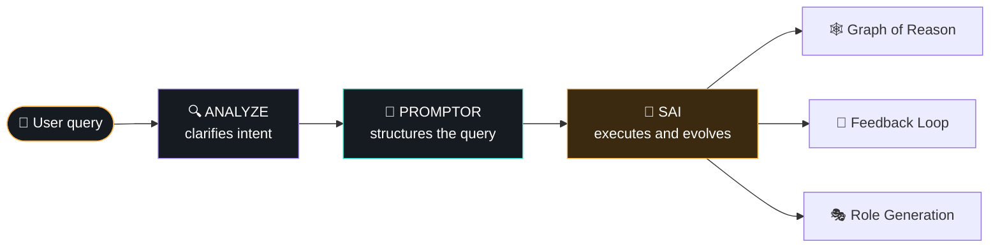

 

**[⚡ Featured](#-featured-projects) · [🧠 SAI](#-sai-self-adaptive-intelligence) · [📈 Activity](#-activity) · [🧰 Stack](#-stack) · [📚 All repositories](#-all-repositories)**

## 👋 About

<table>
<tr>
<td width="50%" valign="top">

### What I do

I design **AI systems that think in layers**: multi-agent cognitive frameworks, prompt architectures and reasoning pipelines.
Around that I build the things that make them usable: full-stack prototypes and Linux tooling.

</td>
<td width="50%" valign="top">

### Right now

- 🧠 **SAI** — a modular cognitive framework
- 🎓 **Competency Tracker** — student skill profiles from a digital footprint
- ⌨️ **ZMK keyboards** — firmware, OBS overlay, configs
- 🔭 Exploring multi-agent architectures and LLM reasoning

</td>
</tr>
</table>

> **Approach — Triple Talk:** logic + creativity + intuition, with every constraint treated as a growth point.

## ⚡ Featured projects

<table>
<tr>
<td width="50%"></td>
<td width="50%"></td>
</tr>
<tr>
<td></td>
<td></td>
</tr>
<tr>
<td></td>
<td></td>
</tr>
</table>

Cards are generated from the GitHub API and refresh daily. Competency Tracker is source-visible for evaluation only; see its license.

## 🧠 SAI: Self-Adaptive Intelligence

> A modular cognitive framework that restructures how AI thinks, reasons and evolves.

| Capability | What it does |
|---|---|
| `.feedback_loop` | recursive self-improvement |
| `.graph_of_reason` | multi-layer logical analysis |
| `.auto_mpr` | metaphor-driven creative reasoning |
| `.constraint_solver` | turns limits into growth points |

## 📈 Activity

  

  

Drawn by <a href="scripts/profile_build.py"><code>scripts/profile_build.py</code></a> from the GitHub API, no third-party stat services. Updated daily by a workflow.

## 🧰 Stack

| Area | What I work with |
|---|---|
| **AI** | prompt engineering, multi-agent systems, LLM reasoning architectures, ChatGPT and Claude APIs, local models via Ollama |
| **Web and product** | Next.js, React, TypeScript, Tailwind CSS, SQLite, motion and UX |
| **Systems** | Linux, Python and Bash tooling, hardware control, ZMK/QMK keyboard firmware |

## 📚 All repositories

<b>🎓 Web and product</b>

 

| Project | Description | Status |
|---|---|---|
| [🎓 competency-tracker](https://github.com/NoFilterA1/competency-tracker) | Student competency tracking from a digital footprint: profiles, curator panel, consent center, QR passport |  |

<b>🧠 AI and cognitive systems</b>

 

| Project | Description | Status |
|---|---|---|
| [🧠 SAI_instructions](https://github.com/NoFilterA1/SAI_instructions) | Self-Adaptive Intelligence: cognitive framework with 9 analysis techniques and a 10-phase pipeline |  |
| [⚖️ LEX.KG](https://github.com/NoFilterA1/LEX.KG) | Intelligent legal assistant for document navigation and legal interaction |  |
| [🌍 WINDROOS](https://github.com/NoFilterA1/WINDROOS) | Adaptive AI guide for daily life and Netherlands law integration |  |
| [🏕️ AI Consultant Altai](https://github.com/NoFilterA1/AI_Consultant_Altai_Camp) | Living AI consultant powered by prompt engineering |  |
| [🌐 TranslAI](https://github.com/NoFilterA1/translAI) | Real-time streaming translator with Ollama support |  |

<b>🛠️ System utilities and tools</b>

 

| Project | Description | Status |
|---|---|---|
| [🌈 OMEN HUB Linux](https://github.com/NoFilterA1/omen-hub/) | GPU, fan and RGB control for OMEN GAMING 17 |  |
| [🎵 SSH Music TUI](https://github.com/NoFilterA1/ssh-music-tui) | Control Spotify and system volume over SSH with a CAVA visualizer in the terminal |  |
| [⌨️ ZMK Config](https://github.com/NoFilterA1/nzmk-config) | Homemade ZMK firmware configuration |  |
| [🎬 OBS ZMK Widget](https://github.com/NoFilterA1/obs-zmk-widget) | Real-time ZMK keyboard overlay for OBS with layer detection and a full theme editor |  |
| [⌨️ Vial QMK](https://github.com/NoFilterA1/vial-qmk) | Corne keyboard firmware and layout configuration |  |
| [🔒 DAL](https://github.com/NoFilterA1/DAL) | Device Access Locker: Python tool for app and service blocking via iptables and ARP spoofing |  |

<b>📚 Study and reference</b>

 

| Project | Description | Status |
|---|---|---|
| [📊 Data Analysis Study](https://github.com/NoFilterA1/Data-Analysis-Study) | Learning and experimentation with data analysis techniques |  |

### 💡 Philosophy

*"SAI is not a tool. It's a platform that shapes the future by transforming every constraint into a new opportunity for intellectual growth."*

 

